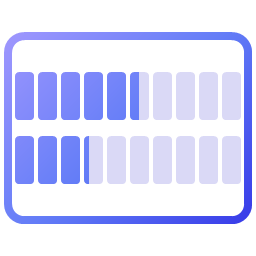

<!-- markdownlint-disable MD004 MD033 -->

<div align="center">

**English** | [Русский](README_RU.md)



# Codex Usage Monitor


[](https://github.com/darhanger/Codex-Usage-Monitor/blob/main/LICENSE)
[](https://github.com/darhanger/Codex-Usage-Monitor/releases/latest)
[](https://github.com/darhanger/Codex-Usage-Monitor/releases)
[](https://discord.gg/ZKFkvrzaU4)

**Codex Usage Monitor** is a lightweight native Windows application that displays Codex, Claude Code and Google Antigravity usage directly in the taskbar.

Designed for **Windows 10 and Windows 11**.

</div>

## Features

The monitor keeps account limits visible without requiring a terminal, browser or provider dashboard.

It provides:

* **5h** and **7d** segmented usage bars.
* A live countdown until each available limit resets.
* Independent columns for **Codex**, **Claude Code** and **Antigravity**.
* One percentage badge in the system tray for every enabled provider.
* Provider-specific notifications when credentials are missing or sign-in is required.
* Left-click tray control for showing or hiding the taskbar widget.
* Right-click menus for refresh, models, polling frequency, language, startup, visibility, position and updates.
* Drag-and-drop placement on primary and secondary taskbars.
* Automatic recovery after Windows Explorer restarts.
* Light and dark Windows taskbar support.
* Portable self-update and optional WinGet update support.

Provider failures are isolated. If one enabled provider is unavailable, the other columns continue updating normally.

## Models and colors

Open the right-click **Models** menu to select the displayed providers.

* **Codex** is enabled by default and uses a lavender → blue → indigo palette.
* **Claude Code** uses a warm terracotta → orange palette.
* **Antigravity** uses a Google blue → green → violet palette.

Each provider has matching usage bars, value text and tray badges. At least one provider always remains enabled.

## Requirements

* Windows **10** or **11**.
* At least one installed and authenticated provider:
  * **Codex** — the official VS Code extension or a recent [Codex CLI](https://developers.openai.com/codex/cli/).
  * **Claude Code** — the CLI or desktop app; Windows and WSL credentials are supported.
  * **Antigravity** — Google Antigravity signed in on Windows.

Codex quota windows require a ChatGPT account login. API-key-only authentication does not expose the same account usage limits.

## Installation

1. Download the latest `codex-usage-monitor.exe` from the [Releases](https://github.com/darhanger/Codex-Usage-Monitor/releases) page.
2. Place the executable in any convenient folder.
3. Run `codex-usage-monitor.exe`.
4. Optionally enable **Start with Windows** from the right-click **Settings** menu.

No installer, browser extension or background service is required.

The WinGet package identifier reserved by the release workflow is:

```text
DarhangeR.CodexUsageMonitor
```

## Usage

The widget appears directly in the Windows taskbar and starts polling enabled providers in the background.

* Drag the thin divider on the left to reposition the widget.
* Drag the widget onto another taskbar to move it to a different monitor.
* Left-click any tray badge to show or hide the widget.
* Right-click the widget or a tray badge to open the application menu.
* Open **Models** to enable or disable provider columns.
* Select **Refresh** to poll immediately and repeat an authentication notification when necessary.

The tray badge normally displays the short-window percentage. If that window is unavailable, it falls back to the available long-window percentage.

## Configuration

The right-click menu provides:

* manual refresh;
* displayed models;
* update intervals of 1 minute, 5 minutes, 15 minutes or 1 hour;
* Start with Windows;
* widget position reset;
* widget visibility;
* interface language;
* release update checks.

The application includes English, Dutch, Spanish, French, German, Japanese, Korean, Traditional Chinese, Simplified Chinese, Russian and Brazilian Portuguese localizations.

Settings are stored in:

```text
%APPDATA%\CodexUsageMonitor\settings.json
```

## How it works

### Codex

The monitor discovers a standalone Codex CLI or the CLI bundled with active VS Code, VS Code Insiders, Cursor and Windsurf extension installations.

Each refresh starts the local [Codex App Server](https://developers.openai.com/codex/app-server/) over stdio and requests `account/rateLimits/read`. Authentication and token refresh remain inside the official Codex executable; the monitor does not read the Codex bearer token.

### Claude Code

The monitor reads Claude OAuth credentials from the standard Windows credentials file or an installed WSL environment and requests Anthropic usage information.

If the dedicated usage endpoint or reset timestamps are unavailable, it can make a minimal Messages API request to read the returned rate-limit headers.

### Antigravity

The monitor reads the `gemini:antigravity` OAuth credential from Windows Credential Manager and requests Google's Cloud Code quota endpoints.

Gemini quota summaries are preferred. Per-model quota data is used as a fallback when the summary is unavailable.

## Notifications

Missing credentials, expired sessions and authentication failures are tracked independently for each provider.

An authentication notification is shown once per error episode to avoid repeated alerts. A successful provider poll resets that state, and selecting **Refresh** can request the notification again.

Transient network failures use retry backoff and are not presented as authentication errors.

## Privacy and security

The application has no analytics or telemetry and does not inspect prompts, conversations or project files.

What the monitor reads:

* standard local authentication stores for enabled providers;
* Codex authentication file metadata only, when waiting for a login change;
* its own UI settings file.

What it sends:

* usage requests to the corresponding provider's HTTPS endpoints;
* requests to GitHub for update checks and portable updates.

Claude and Antigravity credentials are never written by the monitor. Codex authentication is delegated to the official Codex executable.

If `HTTPS_PROXY`, `HTTP_PROXY` or `ALL_PROXY` is configured, direct provider requests may use that proxy. The proxy should therefore be trusted.

## Diagnostics

Run the application with:

```powershell
codex-usage-monitor.exe --diagnose
```

The diagnostic log is written to:

```text
%TEMP%\codex-usage-monitor.log
```

The log records startup, taskbar placement, provider discovery, poll results and notification delivery status. It does not log bearer tokens.

## Building from source

The project requires a current Rust toolchain and Windows MSVC build tools.

```powershell
cargo test --all-targets --locked
cargo clippy --all-targets --locked -- -D warnings
cargo build --release --locked
```

The release binary is created at:

```text
target\release\codex-usage-monitor.exe
```

## Support

For bug reports, feature requests and suggestions, use:

* [GitHub Issues](https://github.com/darhanger/Codex-Usage-Monitor/issues)

When reporting a problem, include:

* the enabled providers;
* the Codex installation type, such as VS Code extension or standalone CLI;
* steps required to reproduce the issue;
* the relevant diagnostic log excerpt;
* a screenshot of the widget or notification, when applicable.

Do not include authentication tokens or credential file contents.

## Contributing

Contributions are welcome.

You can help by:

* reporting bugs;
* testing additional Windows and multi-monitor configurations;
* improving provider compatibility;
* submitting pull requests;
* improving translations or documentation.

## Attribution

The multi-provider taskbar architecture is adapted from [CodeZeno/Claude-Code-Usage-Monitor](https://github.com/CodeZeno/Claude-Code-Usage-Monitor), licensed under MIT.

This project is unofficial and is not affiliated with or endorsed by OpenAI, Anthropic or Google.

## License

This project is distributed under the terms described in the [LICENSE](https://github.com/darhanger/Codex-Usage-Monitor/blob/main/LICENSE) file.

---

<div align="center">

Made for the Windows taskbar

[Download](https://github.com/darhanger/Codex-Usage-Monitor/releases) · [Report an issue](https://github.com/darhanger/Codex-Usage-Monitor/issues) · [Discord](https://discord.gg/ZKFkvrzaU4)

</div>
