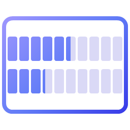

<!-- markdownlint-disable MD004 MD033 -->

<div align="center">

[English](README.md) | **Русский**



# Codex Usage Monitor

[](https://github.com/darhanger/Codex-Usage-Monitor/actions/workflows/build.yml)


[](https://github.com/darhanger/Codex-Usage-Monitor/releases/latest)
[](LICENSE)
[](https://github.com/darhanger/Codex-Usage-Monitor/releases/latest)
[](https://github.com/darhanger/Codex-Usage-Monitor/releases)
[](https://discord.gg/ZKFkvrzaU4)

Лёгкий нативный виджет панели задач Windows для отображения лимитов **Codex**, **Claude Code** и **Google Antigravity**.

</div>

## Возможности

- Сегментированные бары короткого и недельного окон использования с обратным отсчётом до сброса.
- Независимые колонки и процентные индикаторы в трее для каждого включённого провайдера.
- Отдельные уведомления об авторизации и изоляция ошибок провайдеров.
- Обновление одним кликом, настраиваемый опрос, выбор провайдеров и 11 языков интерфейса.
- Перетаскивание между основной и дополнительными панелями задач.
- Автоматическое восстановление после перезапуска Проводника Windows.
- Поддержка DPI каждого монитора, прозрачного виджета с цветами под панель задач и системной, светлой или тёмной темы меню.
- Единственный экземпляр приложения и опциональный автозапуск.
- Портативное самообновление и обновление с учётом установки через WinGet.
- Диагностика по явному запросу без аналитики и телеметрии.

## Скриншоты

В репозитории пока нет очищенного от личных данных скриншота интерфейса. Приложение представляет собой компактный двухстрочный виджет панели задач; перед добавлением скриншотов необходимо проверить их на имена учётных записей, локальные пути, уведомления и другие личные данные.

## Требования

- Windows 10 или Windows 11 на системе с поддержкой x64.
- Установленный и авторизованный поддерживаемый провайдер, настроенный по инструкции ниже.
- Для сборки: стабильный Rust toolchain и инструменты Visual Studio 2022 MSVC C++.

Для окон квот Codex необходима авторизация учётной записи ChatGPT. Авторизация только по API-ключу не предоставляет те же данные о лимитах учётной записи.

## Установка

Каждый GitHub Release содержит два портативных варианта:

- `codex-usage-monitor.exe` — отдельный исполняемый файл, который используют встроенное самообновление и manifest WinGet.
- `CodexUsageMonitor-<version>-Windows-x64.zip` — исполняемый файл вместе с `LICENSE`, `README.md` и `README_RU.md`.

Рядом с обоими файлами публикуются файлы `.sha256`. Для проверки отдельного EXE сравните результат команды PowerShell с `codex-usage-monitor.exe.sha256`:

```powershell
Get-FileHash .\codex-usage-monitor.exe -Algorithm SHA256
```

### Портативная установка

1. Откройте [последний GitHub Release](https://github.com/darhanger/Codex-Usage-Monitor/releases/latest).
2. Загрузите отдельный EXE или версионный ZIP и соответствующую контрольную сумму.
3. Если выбран ZIP, извлеките все файлы в доступный для записи каталог пользователя.
4. Запустите `codex-usage-monitor.exe`.

Портативный пакет не добавляет установщик, расширение браузера или фоновую службу. Храните EXE в доступном для записи каталоге, если встроенное самообновление должно заменять его автоматически.

### Установка через WinGet

Автоматизация релизов использует идентификатор пакета `DarhangeR.CodexUsageMonitor`:

```powershell
winget install --id DarhangeR.CodexUsageMonitor --exact
```

Команда станет доступна только после принятия соответствующего manifest в публичный репозиторий WinGet. Если WinGet не находит этот ID, используйте портативный релиз, пока manifest ожидает публикации.

Автоматический job WingetCreate обновляет уже существующий публичный manifest. Начальный manifest для этого package ID необходимо отправить и дождаться его принятия до того, как автоматическое обновление версий сможет выполняться успешно.

## Первый запуск

1. Выполните вход как минимум в один поддерживаемый провайдер до запуска монитора.
2. Запустите приложение. По умолчанию включён только Codex.
3. Нажмите правой кнопкой на виджет или индикатор в трее и откройте **Модели**, чтобы включить другие провайдеры.
4. При необходимости включите **Настройки > Запускать вместе с Windows**.
5. Перетаскивайте тонкий разделитель слева для размещения виджета.

Одновременно работает только один экземпляр. Если панель задач не принимает встроенное дочернее окно, приложение использует запасное окно поверх остальных.

## Использование

- Перетаскивайте тонкий левый разделитель, чтобы изменить позицию или перенести виджет на другую панель задач.
- Нажмите левой кнопкой на индикатор провайдера в трее, чтобы скрыть или показать виджет.
- Нажмите правой кнопкой на виджет или индикатор, чтобы открыть меню.
- Выберите **Обновить** для немедленного опроса и повторного актуального уведомления об авторизации.
- В меню **Модели** включайте и отключайте колонки провайдеров. Как минимум одна остаётся включённой.
- Выберите интервал опроса: 1 минута, 5 минут, 15 минут или 1 час.
- В пункте **Настройки > Тема** выберите системное, светлое или тёмное оформление контекстного меню.
- Сбросьте сохранённую позицию панели задач через **Настройки**.
- Используйте пункт с номером версии в **Настройках** для проверки или применения обновления.

Индикатор в трее показывает процент короткого окна, а при его отсутствии — процент недельного окна.

## Настройка провайдеров

### Codex

Установите актуальный Codex CLI либо официальное расширение OpenAI для VS Code, VS Code Insiders, VS Code OSS, Cursor или Windsurf и выполните вход. Монитор запускает `codex app-server` через stdio и запрашивает `account/rateLimits/read`; авторизацией и обновлением токена управляет официальный процесс Codex. При ожидании изменения входа монитор отслеживает только метаданные `%CODEX_HOME%\auth.json` или `%USERPROFILE%\.codex\auth.json`.

### Claude Code

Выполните вход в Claude Code в Windows или WSL. Монитор сначала ищет OAuth-данные в `%USERPROFILE%\.claude\.credentials.json`, затем в установленных дистрибутивах WSL по пути `~/.claude/.credentials.json`. При истёкшем токене соответствующий Claude CLI может выполнить минимальный запрос, чтобы CLI самостоятельно обновил свои данные авторизации.

### Google Antigravity

Выполните вход в Antigravity в Windows. Монитор читает универсальные учётные данные `gemini:antigravity` из Диспетчера учётных данных Windows и запрашивает доступную сводку квот через endpoint-ы Google Cloud Code.

Никогда не копируйте настоящие учётные данные в Issue, диагностический фрагмент, конфигурационный файл или тестовые данные.

## Поддерживаемые провайдеры

| Провайдер | Источник авторизации | Источник данных использования |
| --- | --- | --- |
| Codex | Официальный Codex CLI или CLI из IDE | Локальный Codex App Server |
| Claude Code | OAuth-данные Claude в Windows или WSL | Endpoint использования Anthropic с fallback на заголовки rate limit |
| Google Antigravity | Диспетчер учётных данных Windows | Endpoint-ы квот Google Cloud Code |

Ошибки провайдеров изолированы на уровне модели опроса. Сбой одного включённого провайдера не удаляет успешно полученные данные остальных.

## Настройка

Меню управляет видимостью провайдеров, интервалом опроса, видимостью и позицией виджета, темой, языком, автозапуском и обновлениями. Настройки интерфейса сохраняются по адресу:

```text
%APPDATA%\CodexUsageMonitor\settings.json
```

Автозапуск хранится отдельно в ключе `Run` текущего пользователя. Поля, значения по умолчанию, переменные proxy и требования провайдеров описаны в документе [Настройка](docs/CONFIGURATION_RU.md).

Поддерживаются английский, нидерландский, испанский, французский, немецкий, японский, корейский, традиционный китайский, упрощённый китайский, русский и бразильский португальский языки.

## Каналы обновления

| Канал | Определение | Поведение обновления |
| --- | --- | --- |
| Portable | EXE находится вне известных каталогов пакетов WinGet | Загружает отдельный `codex-usage-monitor.exe`, заменяет текущий файл через вспомогательный процесс и перезапускает приложение |
| WinGet | EXE находится в известном каталоге пакетов WinGet | Выполняет `winget upgrade --id DarhangeR.CodexUsageMonitor --exact` и перезапускает приложение после успеха |

Автоматическая проверка выполняется не чаще одного раза в 24 часа и также запускается из меню. Для портативного обновления каталог приложения должен быть доступен для записи. Контрольные суммы релиза предназначены для ручной проверки; текущий встроенный updater полагается на HTTPS и имя asset в GitHub Release и отдельно не проверяет опубликованный `.sha256`.

## Конфиденциальность и безопасность

Приложение не содержит аналитики или телеметрии и не просматривает запросы, разговоры или файлы проектов. Оно читает только стандартные источники авторизации включённых провайдеров, собственные настройки и метаданные, необходимые для обнаружения изменения учётных данных.

Прямые запросы провайдеров и GitHub используют HTTPS. При наличии `HTTPS_PROXY`, `HTTP_PROXY` или `ALL_PROXY` запросы могут проходить через указанный proxy; используйте только доверенный сервер. Токены находятся в памяти только для запросов провайдера и не должны попадать в логи или репозиторий.

Перед сообщением об уязвимости прочитайте [SECURITY.md](SECURITY.md). Проблемы с учётными данными, заменой обновлений, proxy, диагностикой или WinGet необходимо отправлять через приватные GitHub Security Advisories, а не публичные Issues.

## Диагностика

Запустите приложение с параметром:

```powershell
.\codex-usage-monitor.exe --diagnose
```

Лог заново создаётся в `%TEMP%\codex-usage-monitor.log`. Он содержит сведения о запуске, размещении на панели задач, обнаружении провайдеров, результатах опроса и доставке уведомлений, но не значения bearer-токенов. В нём могут быть локальные пути и данные окружения, поэтому публикуйте только короткий очищенный фрагмент.

## Сборка из исходного кода

```powershell
cargo fmt --all -- --check
cargo clippy --all-targets --locked -- -D warnings
cargo test --all-targets --locked
cargo build --release --locked
```

Исполняемый файл создаётся в `target\release\codex-usage-monitor.exe`. Версия берётся из `Cargo.toml`; `build.rs` встраивает иконку и Windows version metadata.

## Портативная упаковка

После Release-сборки выполните:

```powershell
powershell.exe -NoProfile -ExecutionPolicy Bypass -File .\scripts\package.ps1
```

Скрипт получает версию через `cargo metadata`, проверяет AMD64 PE header, version metadata и связанную иконку, создаёт отдельный EXE, ZIP и SHA-256 в каталоге `artifacts`, а затем повторно открывает ZIP и проверяет его содержимое. Полная последовательность приведена в [чек-листе релиза](docs/RELEASE_CHECKLIST.md).

## Процесс выпуска

- Push и pull request в `main`, а также ручной запуск выполняют форматирование, Clippy, тесты, Release-сборку, упаковку и загрузку artifact через [`build.yml`](.github/workflows/build.yml).
- Успешный push в `main` публикует или обновляет `v<version>` из того же проверенного artifact. Существующий тег на другом commit отклоняется.
- [`release.yml`](.github/workflows/release.yml) заново собирает и проверяет явно отправленный или выбранный вручную существующий тег `vMAJOR.MINOR.PATCH`.
- После успешного GitHub Release возможна отправка отдельного EXE в WinGet, если настроен `WINGETCREATE_GITHUB_TOKEN`.

Единственный источник версии — `Cargo.toml`. Перед выпуском обновите его и [CHANGELOG.md](CHANGELOG.md).

## Документация

- [Architecture](docs/ARCHITECTURE.md) · [Архитектура](docs/ARCHITECTURE_RU.md)
- [Configuration](docs/CONFIGURATION.md) · [Настройка](docs/CONFIGURATION_RU.md)
- [Чек-лист релиза](docs/RELEASE_CHECKLIST.md)
- [История изменений](CHANGELOG.md)
- [Участие в разработке](CONTRIBUTING.md)
- [Политика безопасности](SECURITY.md)

## Поддержка

- Используйте [GitHub Issues](https://github.com/darhanger/Codex-Usage-Monitor/issues) для воспроизводимых ошибок и сфокусированных предложений.
- Используйте [Discord](https://discord.gg/ZKFkvrzaU4) для общения с сообществом.
- Используйте [GitHub Security Advisories](https://github.com/darhanger/Codex-Usage-Monitor/security/advisories/new) для уязвимостей.

Перед публикацией очищайте диагностические логи, скриншоты, локальные пути и сведения об учётной записи.

## Участие в разработке

Вклад в проект приветствуется. Прочитайте [CONTRIBUTING.md](CONTRIBUTING.md), делайте изменения небольшими, сохраняйте изоляцию ошибок провайдеров и неблокирующий UI, синхронизируйте пользовательскую документацию и локализации и выполните все обязательные проверки Cargo перед созданием pull request.

## Благодарности

Мультипровайдерная архитектура виджета панели задач основана на проекте [CodeZeno/Claude-Code-Usage-Monitor](https://github.com/CodeZeno/Claude-Code-Usage-Monitor), распространяемом по лицензии MIT.

Проект является неофициальным и не связан с OpenAI, Anthropic или Google и не поддерживается ими.

## Лицензия

Codex Usage Monitor распространяется по [лицензии MIT](LICENSE).

---

<div align="center">

[Скачать](https://github.com/darhanger/Codex-Usage-Monitor/releases/latest) · [Сообщить об ошибке](https://github.com/darhanger/Codex-Usage-Monitor/issues) · [Discord](https://discord.gg/ZKFkvrzaU4)

</div>
